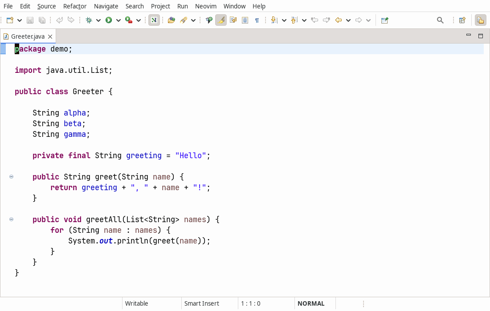

<!-- The header is the logo with the name (docs/images/logo-wordmark.svg; one file for light and
     dark themes). The alt text keeps the name for screen readers and wherever the image does not load. -->
<h1></h1>

Embeds **real Neovim** (`nvim --embed`) in Eclipse text editors so modal editing (motions, operators,
text objects, visual mode, registers, macros, ex commands) works on the buffer you see in the IDE.
Neovim owns editing; Eclipse owns files and rendering.

<!-- docs/images/demo.gif: a loop on a small Java file (ciw, a macro, :%s, gd, content assist in
     insert mode, :e!). It starts and ends on the same frame. Record it again when the behavior it
     shows changes: java releng/tools/marketplace/Marketplace.java pictures (DemoRecordingTest). -->


**Status: 0.2.15, an early release.** It works day to day on Linux, macOS and Windows; expect rough
edges, see [Known limitations](#known-limitations).

**Documentation**

- [docs/USER_GUIDE.md](docs/USER_GUIDE.md): every feature in detail, from the status bar and the
  command line to folding, splits and the preferences. Start here to use the plug-in.
- [docs/LEARNING.md](docs/LEARNING.md): how Eclipse plug-ins and the Neovim API work, as used here.
  Start here if you want to understand or maintain the code.
- [docs/ARCHITECTURE.md](docs/ARCHITECTURE.md): design decisions and how each feature works.
- [docs/KEYBOARD.md](docs/KEYBOARD.md): which keys go to Neovim and which to Eclipse, and why.
- [CONTRIBUTING.md](CONTRIBUTING.md): building, testing, the rules the code relies on, and style.
- [docs/PACKAGING.md](docs/PACKAGING.md), [docs/HOWTO_ECLIPSE.md](docs/HOWTO_ECLIPSE.md),
  [docs/PLATFORM.md](docs/PLATFORM.md): building, running from the IDE, platform notes.
- [docs/UPGRADING.md](docs/UPGRADING.md): moving to a newer JDK, Eclipse, library, tool or Neovim.
- [docs/design/](docs/design/README.md): design notes, one per larger part of the plug-in, each
  with how it works, the experiments behind it, and why it is built that way. For example folding
  with `zo` and `zc`, one Neovim window per editor, and the update site and Marketplace listing.
- [CHANGELOG.md](CHANGELOG.md): what changed in each release.
- [SECURITY.md](SECURITY.md): how to report a vulnerability privately.

## How it behaves

| Eclipse is responsible for | Neovim is responsible for |
|----------------------------|---------------------------|
| Displaying text, caret, visual selection, status line | Motions, text objects, operators, macros, marks, registers, counts, undo |
| Typing in **insert/replace** mode (so content assist and IME keep working) | Everything in normal / visual / operator-pending mode, the mouse included (see [Mouse](docs/USER_GUIDE.md#mouse)) |
| File and tab commands: `:w` `:wa` `:q` `:qa` `:wq` `:x` `:xa` `ZZ` `ZQ`, `:bd`, `:e file`, `:e!`, `:enew`, `:tabn` `:tabp`, `gt` `gT` | All other `:` commands, e.g. `:%s/a/b/g` |
| Vim's windows as editors: `:split`, `:vsplit` and `Ctrl-W s` put an editor beside this one, in an editor stack of its own; `Ctrl-W h/j/k/l` move between them, `Ctrl-W +` sizes them, `:only` gathers them again (see [Splits](docs/USER_GUIDE.md#splits-split-vsplit-ctrl-w)) | Where a split goes (`'splitbelow'`, `'splitright'`), which file it shows, the counts |
| `gd` and `Ctrl-]` (Open Declaration), `K` (hover information), and Neovim's language keys `grn` (Rename), `gra` (Quick Fix), `grr` (References), `gri` (Open Implementation), `grt` (Open Declared Type), `gO` (Quick Outline), through the editor's own commands (see [docs/KEYBOARD.md](docs/KEYBOARD.md)) | Counts and the `g` prefix of those keys |
| The inline command line for `:`, `/`, `?` (typing, history) | Executing the command or search typed there |
| The OS clipboard behind the `"+` and `"*` registers, and a copy of every other yank (see [Clipboard](docs/USER_GUIDE.md#clipboard)) | `p` / `P` / `.` / counts, from Neovim's own registers |
| Finding errors and warnings (compiler, builders, language servers), sent to Neovim as diagnostics (see [Problems](docs/USER_GUIDE.md#problems-d-d)) | `]d` / `[d` / `]D` / `[D` between them, with counts, in macros and the jumplist |
| The workspace's problems and tasks, put in Neovim's quickfix list by `:Eproblems` / `:Etasks`, and the Problems / Tasks view for `:copen` (see [The quickfix list](docs/USER_GUIDE.md#the-quickfix-list-eproblems-q)) | `]q` / `[q`, `:cnext`, `:cc 3` and the rest of Vim's quickfix commands |
| Where the folds are (methods, imports, comments, language-server regions) and drawing them | Opening and closing them: `zo` `zc` `za` `zM` `zR` and the other `z` commands, `j` over a closed fold (see [Folding](docs/USER_GUIDE.md#folding-zo-zc-zm)) |

Details of what happens on each key are in [docs/ARCHITECTURE.md](docs/ARCHITECTURE.md).

## Install

To use the plug-in in your own Eclipse, without building it.

**You need**

- Eclipse IDE **2024-12 (4.34) or newer**, any package (Java, C/C++, Committers, ...), running on
  Java 21 or newer (the Eclipse packages bring their own Java 21+). Every release is installed into
  the oldest and the newest Eclipse before it is published: tested up to 2026-09 (4.41).
- **Nothing else**: the plug-in installs the Neovim it runs, its *dedicated Neovim* (0.12.6), with
  **Get Neovim 0.12.6…**: offered in the "Neovim not started" notice, on
  *Window → Preferences → Neovim* and in the *Neovim* menu. It checks that Neovim's files at every
  start, and runs no other Neovim unless you name one when Eclipse starts
  ([Using a Neovim of your own](#using-a-neovim-of-your-own)). A Neovim from your system's packages
  or `PATH` is not used by itself. See [Get Neovim](docs/USER_GUIDE.md#get-neovim) and [Finding Neovim](docs/USER_GUIDE.md#finding-neovim).

**Steps**

1. In Eclipse: *Help → Install New Software… → Add…*, enter `Neovim for Eclipse` as the *Name* and
   this update site as the *Location*, then *Add*:

   ```text
   https://jm6cnddxbwftaks.github.io/neovim4eclipse/
   ```

   Offline, or to install one particular version: download `neovim4eclipse-<version>.zip` from the
   [Releases](https://github.com/Jm6CnDDXBwFTakS/neovim4eclipse/releases) page and choose
   *Archive…* in place of the URL. Do not unpack it: the ZIP is a complete p2 update site
   (Eclipse's installer format), read as it is.
2. Tick **Neovim for Eclipse**, then *Next*, *Next*, accept the license (EPL-2.0) and *Finish*.
3. Eclipse asks whether to trust the PGP key that signed the plug-in, *Neovim for Eclipse
   releases*. Check that its fingerprint is

   ```text
   A91F 53D8 931B 7FD0 D146  8618 6CC9 E446 147B 063C
   ```

   then tick it and choose *Trust Selected*. Eclipse asks only once: the installed plug-in vouches
   for its own key, so updates install without asking. The site holds only signed releases (0.1.4
   and later; the unsigned 0.1.0 to 0.1.3 remain on GitHub's release pages), so it never asks to
   trust *unsigned content*: if Eclipse asks that, something is wrong. A jar changed after signing
   fails the install, and the site is checked again each time it is rebuilt. To check a release by hand, the key is `releng/signing-key.asc` in this repository and
   on [keys.openpgp.org](https://keys.openpgp.org/search?q=A91F53D8931B7FD0D14686186CC9E446147B063C).
4. Restart Eclipse when asked.
5. The first start opens *Get Neovim 0.12.6…*, which installs the dedicated Neovim. Then open any
   text file: Neovim attaches to the editor automatically. *Neovim → Attach Neovim* attaches by
   hand; the toolbar toggle turns it off and on. The first time, a
   welcome note says how to turn it off and where the preferences and documentation are
   (*Neovim → Welcome...* shows it again). After an update to a new minor version (0.2, 0.3, ...),
   a short note links to the change log instead.

**Updating and removing**

- To update: *Help → Check for Updates* finds each new release on the update site. With a ZIP,
  install the newer ZIP the same way; Eclipse replaces the old version.
- To remove: *Help → About Eclipse IDE → Installation Details → Installed Software*, select
  **Neovim for Eclipse**, *Uninstall…*, and restart. The dedicated Neovim's folder stays (about
  40 MB); delete it by hand ([Get Neovim](docs/USER_GUIDE.md#get-neovim) says where it is).

**Untested builds:** every push to `main` builds the same ZIP. It is attached to the run under the
repository's *Actions* tab (*Build*, latest run, *Artifacts*; downloading needs a GitHub login) and
installs the same way.

To build the ZIP yourself from source, see [CONTRIBUTING.md, "Build and test"](CONTRIBUTING.md#build-and-test) and
[docs/PACKAGING.md](docs/PACKAGING.md); to run the plug-in from the Eclipse IDE while you work on
it, see [CONTRIBUTING.md, "Run it from Eclipse"](CONTRIBUTING.md#run-it-from-eclipse).

## First five minutes

1. **Get Neovim.** The first time, the *Get Neovim 0.12.6…* dialog opens: choose *Download*. It
   fetches the Neovim release from GitHub and checks it before anything runs; until then, editors
   keep Eclipse's keys.
2. **Open a file.** Any text editor attaches: Java, XML, plain text, and the others built on
   Eclipse's text editor. The status bar shows the mode, `NORMAL`, and Neovim's keys apply:
   `hjkl`, `w`, `ciw`, `dd`, `u`, `.`, counts, registers, macros.
3. **Type.** `i`, `a`, `o` enter insert mode, where Eclipse types the text, so content assist,
   templates and your input method work as usual. `Esc` hands the insert to Neovim, so `.` repeats
   it and `u` undoes it.
4. **Run a command.** `:`, `/` and `?` open a command line inside the editor, at its bottom.
   `:%s/old/new/g` runs in Neovim; `:w`, `:q`, `:e file` and the other file commands are Eclipse's
   own Save, Close and Open.
5. **Use the IDE from Vim.** `gd` opens the declaration, `K` shows the hover information, `]d`
   goes to the next problem, `:Eproblems` puts the workspace's problems in the quickfix list.
6. **Give the keys back.** `Ctrl+Shift+M` (`Cmd+Shift+M` on macOS), or the Neovim button in the
   toolbar, turns Neovim mode off in the editor, so Eclipse handles every key there, and on again.
   `Ctrl+S` and `Ctrl+Z` keep their Eclipse meaning (on macOS the `Cmd` shortcuts all stay
   Eclipse's); which other `Ctrl+letter` keys go to Neovim is chosen on
   *Window → Preferences → Neovim → Ctrl Keys*.

Your own Neovim configuration applies ([Your `init.lua` in Eclipse](#your-initlua-in-eclipse)).
Every feature is described in [docs/USER_GUIDE.md](docs/USER_GUIDE.md).

## Your `init.lua` in Eclipse

The embedded Neovim reads your normal config. Some of it makes sense in a terminal but not inside
Eclipse: UI plug-ins, language servers, completion. The plug-in starts Neovim with
`vim.g.neovim4eclipse` set to `1` before any config runs, so your config can skip those parts:

```lua
-- init.lua
vim.opt.ignorecase = true          -- shared by terminal Neovim and Eclipse

if vim.g.neovim4eclipse then
  vim.g.neovim4eclipse_ide_keys = 0       -- settings for Eclipse only go here
  return                           -- the rest is for terminal Neovim only
end

require('lazy').setup('plugins')
```

With lazy.nvim, one plug-in can also be left out with `cond = not vim.g.neovim4eclipse`, for
example a completion plug-in, whose popup the plug-in does not draw:

```lua
{ 'hrsh7th/nvim-cmp', cond = not vim.g.neovim4eclipse },
```

The
variable is set with `--cmd`, not in the environment, so a Neovim you start in a `:terminal` inside
Eclipse does not see it.

**Distributions** (LazyVim, NvChad, AstroNvim and other large configs) are made for a terminal, and
most of what they add draws windows Eclipse does not show (see Known limitations, item 7). With
the LazyVim starter, the plug-in closes the windows that take the focus (lazy.nvim's installer,
with a message), and the plug-ins still install in the background; keys typed in the first seconds
of that first start can be lost, while the installer opens its window again. Later starts edit as
usual, without most of what the distribution shows. Keep such a config out of Eclipse with the
guard above, placed before it loads (`if vim.g.neovim4eclipse then ... return end` ahead of
`require('config.lazy')`), or give Eclipse a small config of its own (*A separate config for
Eclipse*, below).

**Errors in your config.** If `init.lua` reports an error while Neovim starts (a typo, or a
Vimscript line such as `nnoremap ; :` in a Lua file: write `vim.keymap.set('n', ';', ':')`, or wrap
it in `vim.cmd[[...]]`), Neovim starts anyway, with what your config set up before the error (after
a syntax error, none of it), and a warning shows the error. Fix it and choose *Neovim → Restart Neovim...*. The terminal
does the same after you press Enter.

The names the plug-in reads and sets are listed in [Settings](#settings).

**A separate config for Eclipse.** If you would rather keep two configs apart, start Eclipse with
the environment variable `NVIM_APPNAME` set, for example to `eclipse-nvim`.
Neovim then reads `~/.config/eclipse-nvim/init.lua` (on Windows `%LOCALAPPDATA%\eclipse-nvim\init.lua`)
instead of your normal one. It also keeps its data apart: installed plug-ins, history, registers
and marks are not shared with your terminal Neovim. Set it only where Eclipse starts (a small
script that sets it and then runs Eclipse): set for your whole account, it changes your terminal
Neovim too, and `eclipse.ini` cannot set environment variables. Every Neovim started inside that
one, in a `:terminal` too, inherits it.

## Settings

Nothing here needs changing to get started: this is the reference of every name the plug-in
reads from you, or sets for your config to read. These names stay: one is
renamed or removed only after a release that still accepts the old name and warns about it, and the
[change log](CHANGELOG.md) says so. Anything not listed here (other `neovim4eclipse_*` variables,
the plug-in's Lua modules and namespaces, its key-binding contexts) is internal and may change.

**In `init.lua`**, read when Neovim starts (after a change, *Neovim → Restart Neovim...*), except
where the table says otherwise. `0` or `false` turns a part off:

| Name | What it does |
|------|--------------|
| `vim.g.neovim4eclipse_ide_keys = 0` | Keeps Neovim's own `gd`, `Ctrl-]`, `K`, `grn`, `gra`, `grr`, `gri`, `grt`, `gO`, `gt`, `gT` instead of Eclipse's Open Declaration, Rename and the others; `ZZ` and `ZQ` stay Eclipse's ([docs/KEYBOARD.md](docs/KEYBOARD.md)) |
| `vim.g.neovim4eclipse_folds = 0` | Leaves Neovim's folding alone: Eclipse's folds are not copied, and `z` is not mapped ([Folding](docs/USER_GUIDE.md#folding-zo-zc-zm)) |
| `vim.g.neovim4eclipse_viewport = 0` | Neovim keeps a fixed screen of its own instead of the editor's size, scrolling and word wrap ([The editor's size](docs/USER_GUIDE.md#the-editors-size-scrolling-and-word-wrap-h-l-ctrl-d-zz)) |
| `vim.g.neovim4eclipse_problems = 0` | Eclipse's errors and warnings are not sent to Neovim, so `]d` and `[d` are Neovim's own ([Problems](docs/USER_GUIDE.md#problems-d-d)) |
| `vim.g.neovim4eclipse_search_highlight = 0` | The editor does not highlight search matches; search itself works as before ([Command line](docs/USER_GUIDE.md#command-line---)) |
| `vim.g.neovim4eclipse_task_tags = 'TODO,FIXME'` | The comment tags `:Etasks` collects; read each time `:Etasks` runs ([The quickfix list](docs/USER_GUIDE.md#the-quickfix-list-eproblems-q)) |

**Set by the plug-in**, for your config to read:

| Name | What it says |
|------|--------------|
| `vim.g.neovim4eclipse` | `1`, set before your config runs: this Neovim runs inside Eclipse ([Your `init.lua` in Eclipse](#your-initlua-in-eclipse)) |
| `User` autocommand `Neovim4EclipseFolds` | Fires when the closed folds change ([Folding](docs/USER_GUIDE.md#folding-zo-zc-zm)) |
| Diagnostic namespace `neovim4eclipse` | Holds Eclipse's problems inside Neovim ([Problems](docs/USER_GUIDE.md#problems-d-d)) |

**Commands** for Neovim's command line and your mappings:

| Name | What it does |
|------|--------------|
| `:Eclipse[!] <command>` | Runs one of Eclipse's file and tab commands, named as in Vim: `:Eclipse quit`, `:Eclipse! edit file` ([Command line](docs/USER_GUIDE.md#command-line---)) |
| `:Eproblems`, `:Etasks` | Put the workspace's problems, or its task comments, in the quickfix list ([The quickfix list](docs/USER_GUIDE.md#the-quickfix-list-eproblems-q)) |

**Startup options**, each a line after `-vmargs` in `eclipse.ini`:

| Name | What it does |
|------|--------------|
| `-Dneovim4eclipse.nvim=<program>` | Runs that Neovim program instead of the dedicated one ([Using a Neovim of your own](#using-a-neovim-of-your-own)) |
| `-Dneovim4eclipse.logLevel=FINE` | How much the plug-in logs ([The plug-in's log](docs/USER_GUIDE.md#the-plug-ins-log)) |

**Preferences**, on *Window → Preferences → Neovim* and its pages
([Preferences](docs/USER_GUIDE.md#preferences)). Each is stored under the key in the second column,
which an administrator can set for everyone in the product's `plugin_customization.ini`, as
`io.github.jm6cnddxbwftaks.neovim4eclipse/<key>=<value>`:

| Preference | Key |
|------------|-----|
| Show the Neovim button on the main toolbar | `showToggleButton` |
| Show Neovim menu in the menu bar | `showMenu` |
| Flash the editor on errors | `flashOnError` |
| Show a welcome after installing, and a note after updates to a new minor version | `showWelcome` |
| Status Bar: *mode* | `statusMode` |
| Status Bar: *cmd* (the pending command, Vim's `showcmd`) | `statusShowcmd` |
| Status Bar: *statusline* (Neovim's `'statusline'`) | `statusStatusline` |
| Status Bar: *Statusline width (characters)* | `statusStatuslineWidth` |
| Status Bar: *At most this share of the status bar (%)* | `statusMaxWidthPercent` |
| Ctrl Keys: `Ctrl+letter` to Neovim in normal and visual mode | `ctrlKeyNormal.<letter>`, e.g. `ctrlKeyNormal.v` |
| Ctrl Keys: `Ctrl+letter` to Neovim in insert mode | `ctrlKeyInsert.<letter>`, e.g. `ctrlKeyInsert.w` |

**In Eclipse's own settings**, stored under these ids:

- the plug-in's commands on *Window → Preferences → General → Keys*, listed there by name:
  *Neovim: Toggle Neovim / Eclipse Mode* (`io.github.jm6cnddxbwftaks.neovim4eclipse.commands.toggleMode`),
  *Neovim: Attach Neovim* (`.attach`), *Detach Neovim* (`.detach`), *Restart Neovim* (`.restart`),
  *Get Neovim* (`.getNeovim`), *Preferences* (`.openPreferences`), *Welcome* (`.welcome`),
  *Report a Problem* (`.reportProblem`), and
  *Neovim: Ctrl-A (Increment number)* to *Ctrl-Z* (`.ctrl.a` to `.ctrl.z`);
- the color *Neovim for Eclipse → Search match* in *Colors and Fonts*
  (`io.github.jm6cnddxbwftaks.neovim4eclipse.searchMatch`).

**The dedicated Neovim's folder**, `neovim4eclipse-plugin` in your data folder
([Get Neovim](docs/USER_GUIDE.md#get-neovim) says where).

## Using a Neovim of your own

Where the dedicated Neovim cannot run (a system Neovim publishes no build for, or where the official
one does not run: Alpine and other musl-based Linux, NixOS without nix-ld, FreeBSD), or when a newer
Neovim has a security fix you need that *Get Neovim* does not offer yet, name another Neovim program when
Eclipse starts, with the Java system property `neovim4eclipse.nvim`. The value is the program's
absolute path (`/usr/bin/nvim`, `C:\tools\nvim\bin\nvim.exe`; a leading `~` stands for the home
folder). That program is **run unchecked and unsupported**, so be sure it is Neovim, 0.12.6 or newer.
A folder is refused (the note names the program inside it, such as `<folder>/bin/nvim`), as are a
command name (`nvim`) and a relative path: nothing is looked up or searched. Naming a dedicated
Neovim's own `bin/nvim` runs that install as the dedicated Neovim: checked before every start.

For one start, on the command line:

```bash
eclipse -vmargs -Dneovim4eclipse.nvim=/usr/local/bin/nvim
```

On macOS, `/Applications/Eclipse.app/Contents/MacOS/eclipse -vmargs -D…` or
`open -a Eclipse --args -vmargs -D…`; on Windows, `eclipse.exe -vmargs -D…`. To keep it, add the line
`-Dneovim4eclipse.nvim=/usr/local/bin/nvim` after `-vmargs` in `eclipse.ini` (on macOS inside
`Eclipse.app/Contents/Eclipse/`). The note on *Window → Preferences → Neovim* then names the program,
"from -Dneovim4eclipse.nvim"; remove the option, and restart Eclipse, to go back to the dedicated
Neovim.

A `-vmargs` on the command line adds to `eclipse.ini`'s own only if `eclipse.ini` has the line
`--launcher.appendVmargs`, which the Eclipse packages have (checked on Linux, macOS and Windows).
Without it, the command line replaces them (on macOS, Eclipse then does not start); put the option
in `eclipse.ini` instead.

Before 0.2.1 this was the *Neovim program* preference. It is no longer read: a value still stored
there is shown once, with the line to use instead, and then removed. A startup option cannot arrive
in a preferences file imported from elsewhere (*File → Import → Preferences*), which could have
named any program for the plug-in to run.

## Known limitations

What does not work as in Vim, and why. Each is a deliberate choice or a limit of Eclipse; an
[issue](https://github.com/Jm6CnDDXBwFTakS/neovim4eclipse/issues) is welcome where one of them
gets in your way:

1. **A Neovim window per editor, each in a hidden tab of its own.** Each open document has its own
   Neovim buffer (named after the file, so undo history and marks survive switching editors), and
   each editor its own Neovim window, which keeps that editor's cursor, column, scroll position,
   folds, window options (`:setlocal`), jump history, location list and folder (`:lcd`) while
   other editors are active. Two editors on one file (*Window → Editor → Clone*) share its text, undo
   history and marks, and each has its own cursor, as two Vim windows on one buffer. Only the
   active editor is attached. Vim's splits are editors in stacks of their own
   ([Splits](docs/USER_GUIDE.md#splits-split-vsplit-ctrl-w)); Vim's tab commands (`:tabedit`, `:tabclose 2`) work
   on Eclipse's editor tabs, since each editor tab is a window already.
   Jumps into another open file (Ctrl-O, Ctrl-^, `'A`, `:b`, and `:e` of a file that has an editor)
   activate its editor (after `:bufdo` or `:argdo`,
   only the editor of the file they end in), and the window goes along: the two editors swap
   windows, so Ctrl-O there keeps going back through one jump history, as in one Vim window
   ([docs/design/WINDOWS.md](docs/design/WINDOWS.md)). Switching editors in Eclipse (a tab click,
   Ctrl+F6) is no Neovim jump: once the editor's own jump history runs out, Ctrl-O and Ctrl-I are
   Eclipse's Back and Forward, which recorded the switch ([docs/KEYBOARD.md](docs/KEYBOARD.md)).
   Back steps over the switches the plug-in made for Neovim's jumps, which Neovim's history
   already has, and Ctrl-I comes back through the same places Ctrl-O went. A jump into a project's
   file that has no editor open (`gf`, `'A`, `:b 3` of a closed file, Ctrl-^, a quickfix entry)
   opens its editor and goes along the same way. Jumps to anything else (`:help`, a file outside the
   open projects, a file Eclipse opens in another program, such as a `.zip`) are undone. When a
   file's last editor closes, its buffer is kept, as after Vim's `:bd`: `:ls!` lists it with `u`,
   and its number, marks and last cursor position come back when the file is opened again (its undo
   history goes, as in Vim). Changes Neovim makes to another open file (`:bufdo`, `:argdo`)
   reach that file's editor, which is then dirty: save them with `:wa`, *File → Save All*, or in the
   same command (`:bufdo %s/old/new/g | update`).
2. **Block-visual `I` / `A` / `c` disable Eclipse typing for that insert.** To let Vim repeat the text on
   every line, all keys go to Neovim until Esc, so content assist and IME composition do not work in that
   one kind of insert. Plain `i`, `a`, `o` ... are unaffected.
3. **Eclipse's commands are a fixed set** (the table in [Command line](docs/USER_GUIDE.md#command-line---)). `:w other.txt`, `:5,10w part.txt` and `:saveas new.txt` work as in Vim, but `:file name` is undone; `:e` does not expand wildcards (`:e *.txt`); a `:q` that Neovim runs itself (from `<Cmd>`, Lua, after
   `:let ... |` or inside `:bufdo`) is Neovim's, and on Neovim's last window it ends Neovim; tab commands only move within the current editor
   stack (one half of a split editor area). A new file's editor (`:e newfile`) saved with `Ctrl+S` or
   *File › Save* gets Eclipse's Save As dialog, since Eclipse treats a missing file as deleted; `:w`
   creates it.
4. **The line after a final newline.** Eclipse shows an empty line after a file's final newline,
   where Neovim has none, so motions cannot reach it (`G` stops on the line above). A file without
   a final newline keeps none, as with Vim's `'noeol'`: `o` on its last line adds an empty line that
   motions do reach.
5. **Other Vim plug-ins (Vrapper).** Installed together with [Vrapper](https://github.com/vrapper/vrapper),
   Neovim for Eclipse gets the keys while it is attached: each key is handled once, by Neovim
   (tried with Vrapper 0.74.0 on Eclipse 4.34). Vrapper's own mode display stays in the status bar,
   though, and keeps showing `-- NORMAL --` whatever Neovim's mode is. Turn Vrapper off with its
   toolbar button, or uninstall it, to avoid the second display. Other Vim emulations have not
   been tried.
6. **`z` is a mapping in editors that fold.** So that `zf`, `zd` and `zE` cannot change Eclipse's
   folds even when typed slowly, `z` is mapped there and reads the next key itself (two-key
   mappings would time out after `'timeoutlen'`). Every other `z` command works as before, with
   counts, and a mapping of yours of `z` and one key (`zR`, `zz`) still runs. Not covered: your
   mappings of three or more keys starting with `z` (`zxy`) do not run in those buffers; plugins
   that list what can follow `z` (which-key) show nothing there; and `:normal! zE` or a
   `nnoremap` to `zE` still reach Neovim's own `zE`. Other buffers are not affected, and
   `vim.g.neovim4eclipse_folds = 0` leaves `z` alone everywhere.
7. **Neovim plug-ins that draw are not shown.** Eclipse draws the editor; Neovim's floating windows
   are not drawn: completion menus (nvim-cmp, blink.cmp), pickers (Telescope, fzf-lua), file trees,
   dashboards, notifications, an installer's progress window. Plug-ins that work on text
   (surround, commentary, text objects, mappings of your own) work as in a terminal. A floating window
   that opens with the focus (a picker's prompt, `:Lazy`) is closed again at once, with a message,
   since it would take the keys typed in the editor; one without the focus stays, unseen. A plug-in
   can still slip one past (a window opened without autocommands, or focused a moment later); if
   keys seem to do nothing, *Neovim → Restart Neovim...* starts a fresh Neovim. Leave such plug-ins
   out in Eclipse (`cond = not vim.g.neovim4eclipse` with lazy.nvim, or the guard in
   [Your `init.lua` in Eclipse](#your-initlua-in-eclipse)).

## Reporting a problem

Choose *Neovim → Report a Problem...*: it shows what a report needs (the versions, which Neovim, the
settings you changed, the plug-in's last warnings), with no text of your files and your home folder
written as `~`. Read it, then *Copy and Open Issues* copies it and opens the
[issues](https://github.com/Jm6CnDDXBwFTakS/neovim4eclipse/issues/new/choose); paste it into the
bug report, with the keys you typed and what you saw and expected. More detail is in the plug-in's
log, switched on with one startup option ([The plug-in's log](docs/USER_GUIDE.md#the-plug-ins-log)).
A security problem goes through [SECURITY.md](SECURITY.md) instead, privately.

## AI assistance

This project is developed with AI assistance: much of the code, tests and documentation was written
with [Claude Code](https://claude.com/claude-code), Anthropic's coding assistant, under the
maintainer's direction and review. Every change goes through the same checks as hand-written code:
the unit, text-model, SWT and UI test suites, mutation checks of new tests (break the code on
purpose, see the test fail), and manual checks on Linux, macOS and Windows.

The instructions such tools follow in this repository are in [AGENTS.md](AGENTS.md) (Claude Code
reads it through `CLAUDE.md`): the commands, the rules the code depends on, and the conventions.
They are the same rules a human contributor follows ([CONTRIBUTING.md](CONTRIBUTING.md)).

## License

Copyright (c) 2026 Jm6CnDDXBwFTakS.

Licensed under the [Eclipse Public License 2.0](LICENSE), the license of the Eclipse Platform
itself. Each source file carries a short [SPDX](https://spdx.dev/) header that says the same thing.

See [ACKNOWLEDGEMENTS.md](ACKNOWLEDGEMENTS.md) for the project whose design this one follows and for
the embedded libraries.
