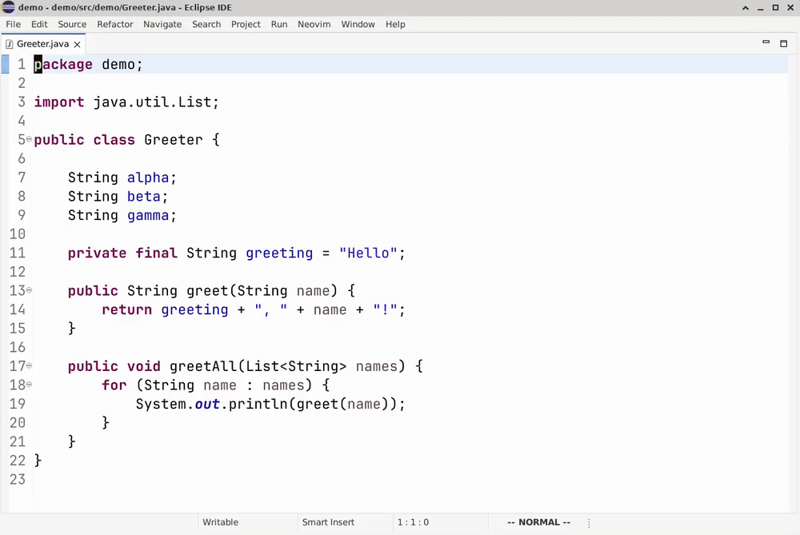

<!-- The header is the logo with the name (docs/images/logo-wordmark.svg; one file for light and
     dark themes). The alt text keeps the name for screen readers and wherever the image does not load. -->
<h1></h1>

Embeds **real Neovim** (`nvim --embed`) in Eclipse text editors so modal editing (motions, operators,
text objects, visual mode, registers, macros, ex commands) works on the buffer you see in the IDE.
Neovim owns editing; Eclipse owns files and rendering.

<!-- docs/images/demo.gif: a 42-second loop on a small Java file (ciw, a macro, :%s, gd, content
     assist in insert mode, :e!). It starts and ends on the same frame. Record it again when the
     behavior it shows changes. -->


**Status: 0.1.7, an early release.** It works day to day on Linux, macOS and Windows; expect rough
edges, see [Known limitations](#known-limitations).

**Documentation**

- [docs/LEARNING.md](docs/LEARNING.md): how Eclipse plug-ins and the Neovim API work, as used here.
  Start here if you want to understand or maintain the code.
- [docs/ARCHITECTURE.md](docs/ARCHITECTURE.md): design decisions and how each feature works.
- [docs/KEYS.md](docs/KEYS.md): which keys go to Neovim and which to Eclipse, and why.
- [CONTRIBUTING.md](CONTRIBUTING.md): building, testing, the rules the code relies on, and style.
- [docs/PACKAGING.md](docs/PACKAGING.md), [docs/HOWTO_ECLIPSE.md](docs/HOWTO_ECLIPSE.md),
  [docs/PLATFORM.md](docs/PLATFORM.md): building, running from the IDE, platform notes.
- [docs/UPGRADING.md](docs/UPGRADING.md): moving to a newer JDK, Eclipse, library, tool or Neovim.
- [docs/design/](docs/design/README.md): design notes, one per larger change, each with its status
  (planned or built), the experiments behind it and the decisions made. For example how Tab
  completion in the `:` command line works, the plan for folding with `zo` and `zc`, and the plan
  for the Eclipse Marketplace listing.
- [CHANGELOG.md](CHANGELOG.md): what changed in each release.
- [SECURITY.md](SECURITY.md): how to report a vulnerability privately.

## How it behaves

| Eclipse is responsible for | Neovim is responsible for |
|----------------------------|---------------------------|
| Displaying text, caret, visual selection, status line | Motions, text objects, operators, macros, marks, registers, counts, undo |
| Typing in **insert/replace** mode (so content assist and IME keep working) | Everything in normal / visual / operator-pending mode, the mouse included (see [Mouse](#mouse)) |
| File and tab commands: `:w` `:wa` `:q` `:qa` `:wq` `:x` `:xa` `ZZ` `ZQ`, `:bd`, `:e file`, `:e!`, `:tabn` `:tabp`, `gt` `gT` | All other `:` commands, e.g. `:%s/a/b/g` |
| `gd` (Open Declaration) and `K` (hover information), through the editor's own commands | Counts and the `g` prefix of those keys |
| The inline command line for `:`, `/`, `?` (typing, history) | Executing the command or search typed there |
| The OS clipboard behind the `"+` and `"*` registers, and a copy of every other yank (see [Clipboard](#clipboard)) | `p` / `P` / `.` / counts, from Neovim's own registers |

Details of what happens on each key are in [docs/ARCHITECTURE.md](docs/ARCHITECTURE.md).

## Install

To use the plug-in in your own Eclipse, without building it.

**You need**

- Eclipse IDE **2024-12 (4.34) or newer**, any package (Java, C/C++, Committers, ...), running on
  Java 21 or newer (the Eclipse packages bring their own Java 21+).
- **Neovim 0.12.6 or newer**: `nvim --version` in a terminal should print it. The plug-in follows
  new Neovim releases closely, so a system package is often too old. A Neovim of its own is fine:
  extract the release archive from [Neovim's releases](https://github.com/neovim/neovim/releases)
  into `~/.local/share/neovim4eclipse-plugin/neovim` (Windows:
  `%USERPROFILE%\.local\share\neovim4eclipse-plugin\neovim`; with `XDG_DATA_HOME` set,
  `$XDG_DATA_HOME/neovim4eclipse-plugin/neovim`), no install needed: the plug-in looks there first.
  Eclipse sees only the environment variables of whatever started it, so one set in your shell's
  startup file does not count when Eclipse starts from the Dock or the Start menu; the preference
  page shows the folder it uses. Or extract it anywhere and choose that folder in
  *Window → Preferences → Neovim*, which shows the Neovim it finds and its version. Archives may sit
  a few folders down (as Windows Explorer's *Extract All* leaves them), and several versions side
  by side in one folder are fine; the newest is used. An older Neovim is refused
  with a message that names both versions.

  ```bash
  mkdir -p ~/.local/share/neovim4eclipse-plugin/neovim
  tar -xzf nvim-linux-x86_64.tar.gz -C ~/.local/share/neovim4eclipse-plugin/neovim
  ```

**Steps**

1. In Eclipse: *Help → Install New Software… → Add…*, enter `Neovim for Eclipse` as the *Name* and
   this update site as the *Location*, then *Add*:

   ```text
   https://jm6cnddxbwftaks.github.io/neovim4eclipse/
   ```

   Offline, or to install one particular version: download `neovim4eclipse-<version>.zip` from the
   [Releases](https://github.com/Jm6CnDDXBwFTakS/neovim4eclipse/releases) page and choose
   *Archive…* in place of the URL. Do not unpack it: the ZIP is a complete p2 update site
   (Eclipse's installer format), read as it is.
2. Tick **Neovim for Eclipse**, then *Next*, *Next*, accept the license (EPL-2.0) and *Finish*.
3. Eclipse asks whether to trust the PGP key that signed the plug-in, *Neovim for Eclipse
   releases*. Check that its fingerprint is

   ```text
   A91F 53D8 931B 7FD0 D146  8618 6CC9 E446 147B 063C
   ```

   then tick it and choose *Trust Selected*. Eclipse asks only once: the installed plug-in vouches
   for its own key, so updates install without asking. (Releases 0.1.0 to 0.1.3 are unsigned; for
   those Eclipse asks to trust *unsigned content* instead.) A jar changed after signing fails the
   install. To check a release by hand, the key is `releng/signing-key.asc` in this repository and
   on [keys.openpgp.org](https://keys.openpgp.org/search?q=A91F53D8931B7FD0D14686186CC9E446147B063C).
4. Restart Eclipse when asked.
5. Open any text file: Neovim attaches to the editor automatically. *Neovim: Attach to Active Editor*
   (`Ctrl+Shift+N`) attaches by hand; the toolbar toggle turns it off and on. The first time, a
   welcome note says how to turn it off and where the preferences and documentation are
   (*Neovim → Welcome...* shows it again). After an update to a new minor version (0.2, 0.3, ...),
   a short note links to the change log instead.

**Updating and removing**

- To update: *Help → Check for Updates* finds each new release on the update site. With a ZIP,
  install the newer ZIP the same way; Eclipse replaces the old version.
- To remove: *Help → About Eclipse IDE → Installation Details → Installed Software*, select
  **Neovim for Eclipse**, *Uninstall…*, and restart.

**Untested builds:** every push to `main` builds the same ZIP. It is attached to the run under the
repository's *Actions* tab (*Build*, latest run, *Artifacts*; downloading needs a GitHub login) and
installs the same way.

To build the ZIP yourself from source, see [Build and test](#build-and-test) and
[docs/PACKAGING.md](docs/PACKAGING.md); to run the plug-in from the Eclipse IDE while you work on
it, see [Run it (PDE)](#run-it-pde).

## Prerequisites

For developers: building from source and running the plug-in from the IDE. Only Eclipse and Neovim
are needed to [install](#install) it.

- **JDK 21 or newer** for the build. Maven itself is not needed: `./mvnw` (Windows: `mvnw.cmd`) downloads
  the version pinned in `.mvn/wrapper/maven-wrapper.properties`.
- Eclipse IDE with PDE, **2024-12 (4.34) or newer** (the supported minimum; the build targets it), running on Java 21+, with a **JDK 21** registered for the JavaSE-21 execution environment
- **Neovim 0.12.6+** in `~/.local/share/neovim4eclipse-plugin/neovim`, reachable from the Eclipse
  process (`nvim --version`),
  or its folder set in *Window → Preferences → Neovim*

> Eclipse started from a desktop launcher may not inherit your shell `PATH`. Start it from a
> terminal, or set Neovim's folder in the preferences.

## Run it (PDE)

1. Run `./mvnw generate-resources` once (or any full build) to download the Java dependencies into
   `plugins/io.github.jm6cnddxbwftaks.neovim4eclipse/lib/`. Their versions are set only in the root `pom.xml`.
2. *File → Import → Existing Projects into Workspace* → `plugins/io.github.jm6cnddxbwftaks.neovim4eclipse`.
3. Open `META-INF/MANIFEST.MF` → *Launch an Eclipse application*. See [docs/HOWTO_ECLIPSE.md](docs/HOWTO_ECLIPSE.md).
4. Open a text file; Neovim attaches automatically (or press `Ctrl+Shift+N`, *Neovim: Attach to Active Editor*).

Things to try: `hjkl`, `diw`, `ci"`, `dd`, `u`, `v` + motion, `i … Esc`, `:` then `%s/foo/bar/g`, `/pattern`.

## Build and test

```bash
./mvnw clean verify                          # plug-in + unit, text-model and SWT tests + feature + p2 update site
./mvnw clean verify -Pui                     # the same plus the UI tests, which open an Eclipse window
./mvnw verify -DskipTests                    # the same without any tests (no display needed)
./mvnw test -f tests/unit/pom.xml            # unit tests only (no Eclipse, no Neovim needed)
./mvnw test -f tests/unit/pom.xml -Pintegration   # needs `nvim` on PATH (or -Dnvim.path=...)
```

There are two test modules:

- `tests/unit` is a plain Maven jar module: part of the reactor, and also runnable alone. It compiles and
  tests the **headless** packages (`util`, `core`) without Eclipse.
- `tests/io.github.jm6cnddxbwftaks.neovim4eclipse.tests` is a **test fragment** of the plug-in. Tycho starts
  a real Eclipse workbench with the plug-in installed and runs its tests on the UI thread: the Eclipse glue
  (`editor`, `prefs`) on real SWT widgets, and end-to-end tests that open a text editor, type keys and check
  the document. The end-to-end tests need `nvim` (skipped otherwise; `-Dnvim.path=...` selects one).
  The workbench needs a display: it opens briefly on your desktop, and on a headless Linux machine run the
  build under `xvfb-run -a`.

The p2 update site is produced under
`releng/.../target/repository/`, and as the installable archive
`releng/.../target/neovim4eclipse-<version>.zip` (see [docs/PACKAGING.md](docs/PACKAGING.md)).

### Continuous integration

GitHub Actions ([.github/workflows](.github/workflows)) runs the same commands:

- **Build** runs on every push and pull request to `main`, and on demand on any branch (Actions
  tab > Build > Run workflow; release branches are built this way, see CONTRIBUTING.md,
  "Releasing"). It runs `./mvnw verify -Pui` (UI tests under `xvfb-run`) and the integration tests against a pinned Neovim
  release, on Linux, and again on Windows and macOS (the `platforms` job), and attaches the installable ZIP to the run as it is: `neovim4eclipse-<version>.zip`, ready for
  *Install New Software → Add → Archive* without unpacking.
- **Release** runs when you push a tag such as `v0.1.0`, and stops at once unless the tagged
  commit is on `main`. It runs the Build workflow itself (as a
  reusable workflow, so with the same Neovim and all the same tests) for that version (the tag's
  `0.1.0` replaces the committed `0.1.0-SNAPSHOT`), and only when that passes publishes a GitHub
  Release with `neovim4eclipse-0.1.0.zip` attached.

## Layout

```text
plugins/io.github.jm6cnddxbwftaks.neovim4eclipse/
  src/io/github/jm6cnddxbwftaks/neovim4eclipse/
    util/     pure Java: key mapping, mode strings, line/text conversion, range edits, UTF-8 columns
    core/     NeovimSession (process + RPC + events); no SWT/Eclipse imports allowed
      rpc/    the plug-in's own msgpack-rpc client: connection, encoding, typed Neovim API
    sync/     BufferSynchronizer: IDocument <-> Neovim buffer
    editor/   attach/detach, key interception, caret/status UI, :w/:q handling
    prefs/    preference pages (Neovim, Ctrl Keys) and defaults
  lib/        msgpack-core jar (copied by the build; version in the root pom.xml)
tests/unit/   JUnit 5 tests for util + core (sources come from the plug-in; no copies)
features/     feature project (Tycho eclipse-feature)
releng/       p2 category / update-site (Tycho eclipse-repository), release-notes.sh, formatter
docs/         LEARNING, ARCHITECTURE, HOWTO_ECLIPSE, PACKAGING, PLATFORM, UPGRADING, RPC_CLIENT,
              TAB_COMPLETION, LOG_LEVEL, FOLDING, NEW_FILE
.github/      GitHub Actions workflows (build, release), Dependabot, issue templates
pom.xml       Maven/Tycho parent (aggregator)
```

## Status bar

*Window → Preferences → Neovim → Status Bar* chooses which parts of Vim's status information appear in the
Eclipse status bar; changes apply immediately:

| Item | Shows | Default |
|------|-------|---------|
| `mode` | `-- INSERT --`, `-- VISUAL BLOCK --`, `recording @q` | on |
| `cmd` | the pending command as Vim's `showcmd` shows it: `2d`, `"a`, `2f` | on |
| `statusline` | Neovim's own `'statusline'` (your config's, or Vim's default: file, line,col, position) | off |

The parts are joined in that order. `-- ECLIPSE --` is always shown while Neovim mode is off. Only the enabled
parts are requested from Neovim. Messages and errors are not in
the status bar: they appear in the editor (next section).

## Messages and errors

Neovim's latest message or error appears in a line along the bottom of the editor, where Vim shows
its messages and where the `:` box opens:

- **Errors** in the theme's error color: `E486: Pattern not found: x`, `E37: No write since last
  change`, `Can't find file "x"`.
- **Other messages** in the editor's text color: `3 lines yanked`, `3 substitutions on 3 lines`.

As in Vim, the message stays until the next key; a click also hides it. A message too long for the
line ends in `...`. Its tooltip shows all of it, and `:messages` lists the recent ones.

The line shows every message of one line that Neovim gives, whatever printed it: a key, a `:` command
(`:echo "hi"`, `:pwd`), a mapping, a timer or an autocommand; and the plug-in's own errors from the file
and tab commands. Messages of more than one line open the output box described under
[Command line](#command-line---), as Vim would show them above a "Press ENTER" prompt: two
errors at once, a failed save with Neovim's `Error in BufWriteCmd Autocommands` line above it, a Lua
error with its traceback.

*Window → Preferences → Neovim → Flash the editor on errors* (off by default) also tints the editor for
a moment on each error, like Vim's `'visualbell'`, for when your eyes are on the cursor.

## Command line (`:`, `/`, `?`)

`:`, `/` and `?` open Neovim's own command line, shown in a single text box near the bottom edge of
the editor, as wide as the editor minus a small padding and in the editor's font. Every key you type
in it goes to Neovim, so it behaves exactly like Neovim's command line: Enter runs it, Esc or
Backspace on the empty line cancels, Up/Down browse Neovim's history (the same as in a terminal,
kept between sessions), `Ctrl-R` inserts a register, and your command-line mappings and
abbreviations apply. `:` from visual mode gets `:'<,'>` from Neovim. Clicking elsewhere in Eclipse
cancels the line; switching to another application or input method keeps it. In the box the `Ctrl`
letters ticked in the preferences (see "Ctrl keys") go to Neovim's line (`Ctrl-R`, `Ctrl-U`, `Ctrl-N`),
except `Ctrl-V`, which pastes, and `Ctrl-C` with text selected, which copies (on macOS, Cmd-V and Cmd-C
do that, and `Ctrl-V` is Neovim's). Shift+Insert pastes too, and text from an input method (IME) goes
in the same way. A message that arrives while you type (a timer's `:echo`) shows above the box.

The box opens for every command line Neovim opens: a mapping in your `init.lua`
(`vim.keymap.set('n', ';', ':')`, `vim.keymap.set('n', '<Space>s', ':%s/')`; in Vimscript
`nnoremap ; :`), a count before `:` (`2:` gives `:.,.+1`), `!` with a motion (`!!` gives `:.!`), a
search inside an operator (`d/`), and prompts such as `input()` and `confirm()`.

Tab completes the line as Neovim does (commands, options and their values, buffers, help tags,
variables, functions, file names), following your `'wildmode'`; Shift+Tab goes back. A line above the
box lists the candidates, with the selected one highlighted. File names complete from the editor's
project folder (Neovim's window works there, `:lcd`); `:e` itself still looks next to the current
file first, then in the project.

While you type a search, the editor follows Neovim's match (`'incsearch'`); Esc goes back to where
you were. Neovim's command-line window (`q:`) is not available: it closes at once, with a message;
Up and Down in the box browse the same history.

File and tab commands are carried out by Eclipse, everything else by Neovim.

| Command | Eclipse does |
|---------|--------------|
| `:w`, `:up[date]` | save the editor, with Vim's message (`"A.java" 12L, 340B written`); these are Neovim's own writes, see below |
| `:wa[ll]` | *File > Save All* |
| `:q[uit]` | close the editor (Eclipse asks about changes; `:q!` discards them) |
| `:bd[elete]`, `:bw[ipeout]`, `:bun[load]` | close the editor, as `:q` (each buffer is an editor; `:bd!` discards changes) |
| `:bd N`, `:bd name` (also `:bw`, `:bun`) | close the editor of buffer `N` or of the buffer called `name` (a unique part is enough, as with `:b`); several may follow (`:bd 3 other.txt`). A range closes the editors of the buffers it covers (`:3,5bd`); `:%bd` closes all editors |
| `:qa[ll]`, `:quita[ll]` | close all editors (`:qa!` without asking) |
| `:wq`, `:x[it]`, `:exi[t]` | save, then close |
| `:wqa[ll]`, `:xa[ll]` | save all, then close all |
| `:e[dit] file` | open `file`, looked for next to the current file, then in its project; `./file` and `../file` only from the current file's folder; `~` and absolute paths work. A file not found opens as a new, empty editor next to the current file (`"file" [New]`); nothing is written until `:w` |
| `:w ++p` | as `:w`, and for a new file also create its missing folders (`:wq ++p`, `:x ++p` too) |
| `:e!` | revert the editor to the saved file; `:e` alone reloads it, refused while there are changes |
| `:tabn[ext] [N]`, `:tabp[revious] [N]`, `:tabN[ext] [N]` | next / previous editor tab, or tab N / N tabs back |
| `:tabfir[st]`, `:tabr[ewind]`, `:tabl[ast]` | first / last editor tab |

Neovim reads these commands, so they are written as in Neovim (`:wa`, `:wal`, `:wall`), and they
work wherever a `:` line runs: typed in the box, from a mapping in your `init.lua` (`<leader>q` →
`:q<CR>`), from a macro, with `:normal`, and repeated with `@:`. Neovim hands each one to Eclipse as
`:Eclipse quit`, `:Eclipse! edit file` ..., a command you can also use in your own mappings; the
history keeps what you typed. Each command of a `|` chain is handed over the same way: `:w | q`
writes, then closes the editor (asking first if the save failed), and `:w | echo "saved"` runs the
`echo` after the write. Not handed over, so Neovim's: a line run by `<Cmd>` or Lua
(`vim.cmd.quit()`), the commands `:bufdo` runs, the rest of a line whose command takes `|` as part of
its argument (`:normal`, `:g`, `:let x = 1 | q`), and a range a command does not take (`:5,10w`).

A buffer that Neovim deletes by itself (a Lua plug-in, `<Cmd>bd<CR>`, `:bufdo bd`) closes its
editor too, and so does a `:quit` Neovim runs itself; Eclipse asks about changes as for `:q`.

Writes are Neovim's own: `:w`, `:update`, `:bufdo update`, `vim.cmd.write()` in Lua. Neovim never writes
a file itself; it asks Eclipse to save it (so save actions run as usual) and shows Vim's message. Neovim's
"modified" flag follows Eclipse's unsaved-changes marker, so `:update` saves exactly what Eclipse would,
and `:ls` shows `+` for those files. `:w !cmd` pipes the text to a command, as in Neovim. A write under
another name (`:w other.txt`) or of some lines only (`:5,10w`) is refused; use *File → Save As*.

Every other command is typed into Neovim as you wrote it, so it is in the history, `@:` repeats it and a
macro being recorded contains it. Listings of more than one line (`:ls`, `:jumps`, `:marks`,
`:registers` ...), shell output (`:!ls`, `:!make`), `:messages` and anything else of more than one
line show in a read-only box in the same place, with the command as its first line; output that keeps coming
(`:!make`) is added while the box is open. `j`/`k`, Space/`b`, `g`/`G` and the arrow and page keys
scroll it; any other key or a click closes it. Output that comes while you type elsewhere in Eclipse
(a timer's or an autocommand's) opens the box without taking the keyboard from there. Like a message,
it then closes with your next key or click in the editor, and the key works as usual; click into the
box to scroll it. `:messages` keeps Neovim's message history either way. One-line output (`:echo "hi"`, `:set ts?`, a `:s` report) goes to
the message line instead, as on Neovim's own screen, and so do errors. Your own `:redir` collects as in Vim.

## Mouse

In normal and visual mode the left mouse button is Neovim's, as in Neovim with `'mouse'` on (its
default): a click moves the cursor, a double click selects a word (on a bracket, up to its match), a
triple click selects the line (`V`), a fourth click a block (`Ctrl-V`), dragging selects, and
Shift+click extends the selection. The selection is Neovim's visual selection, so `d`, `y`, `>`, `:`
act on what you see. Your `'mouse'`, `'mousetime'` and mappings such as `<2-LeftMouse>` apply; with
`'mouse'` empty a click only moves the cursor.

Eclipse keeps the mouse in insert mode and in Eclipse mode, and always keeps Ctrl+click (Cmd+click on
macOS: Open Declaration and other hyperlinks), the right button (context menu) and the middle button
(pasting the primary selection on Linux). Dragging selected text to move it is not available in
normal mode; drag in insert mode or Eclipse mode for that.

## Indentation (`o`, `O`, `>>`)

Neovim indents the lines it creates. When a document is attached, the plug-in sets that buffer's
options to match the file:

- **Tabs or spaces, and the width of one level**, are read from the document's own indented lines.
  A file with none yet uses *Preferences › General › Editors › Text Editors › Insert spaces for tabs*.
  `'tabstop'` is always the editor's tab width.
- **Brace languages** (Java, C/C++, C#, JavaScript/TypeScript, Kotlin, Go, Rust, CSS, JSON, ...) get
  `'cindent'`: `o` on a line ending in `{` and `O` on a line starting with `}` start one level in.
  Other files keep `'autoindent'` (the new line copies the current line's indent).

These options replace any your `init.lua` sets for the buffer. Filetype detection is not used, so
your filetype plugins (and language servers they may start) do not run in the embedded Neovim.

## Macros (`q`)

`qa` starts recording into register `a` (the status line shows `recording @a`), `q` stops. Play back with
`@a`, `3@a`, `@@` (last macro) and `@:` (last `:` command). Recording and playback are done by Neovim itself;
the plugin makes sure everything you do is seen by Neovim as keys:

- **Insert mode while recording** is driven by Neovim (every key is forwarded, as for block `I`/`A`), so the
  macro contains exactly what you typed, including arrow keys and Backspace. Eclipse's content assist and
  IME composition are therefore unavailable *while recording*.
- **`:` commands and `/` searches** from the command line are typed into Neovim (`:<cmd><CR>`), so they are
  recorded and `@:` works, `:w`, `:q` and the other commands Eclipse carries out too. The editor gets the
  macro's changes only when it ends, so a `:w` inside a macro saves the text from before the macro.
- **Playback** is applied to the editor as one change when the macro finishes, which is much faster than
  replaying each step and avoids half-finished states. Very long macros are given up to 60 seconds.
- `f/`, `t:`, `r/`, `@:`, `qa` ...: the character after `f F t T r @ m ' \` " q` is an *argument* and always goes
  to Neovim (previously `f/` opened the search box).

Clicks in normal and visual mode are recorded, as Neovim records them (`<LeftMouse>`, without a
position: playback clicks where the mouse was last). Not recorded: actions that happen only in Eclipse. Not supported: the command-line
window (`q:`, `q/`, `q?`). Macros live in Neovim's registers and last until Neovim restarts (for example
after changing the executable preference).

## Repeating inserted text with `.`

`A`, type some text, `Esc`, then `j` and `.` repeats the typed text on the next line (likewise `cw`, `o`,
`i`, ... followed by text, and `".p`). Eclipse does the typing; when you press Esc the plugin re-types that
text into Neovim's insert mode so Neovim records it for `.`, then makes Eclipse's text authoritative again.

This applies when the insert was a plain insertion at one spot. It is **not** recorded (the text stays
correct, but `.` repeats only the command without the text) when you delete text before the insertion
point, edit in two places in one insert, or paste more than 1000 characters. Counts (`3Afoo`) and Replace
mode (`R`) are also not repeated by Neovim in this mode. Insert-mode mappings and abbreviations from your
`init.lua` are cleared in the embedded Neovim (Eclipse never applied them anyway), so that they cannot
hijack the re-typed text.

## Clipboard

Eclipse is the embedded Neovim's *clipboard provider* (`:help clipboard`), so the registers that
stand for the system clipboard work as in Vim, with no `xclip`, `wl-clipboard` or `win32yank` needed:

- `"+p` pastes what was copied in any program, `"+yy` copies a line for any program to paste.
- `"*` is the primary selection on Linux (the text last selected, pasted with the middle mouse button);
  on Windows and macOS it is the same clipboard as `"+`.
- With `set clipboard=unnamedplus` in your `init.lua`, plain `y` and `p` use the clipboard, as in Vim.
- Without it, every yank (`yy`, `dw`, `"ay` ...) is still copied to the clipboard, so text yanked in
  the editor can be pasted elsewhere; plain `p` pastes Neovim's own register.

A whole-line copy ends with a line break, and pasting text that ends with one pastes whole lines. What
Neovim copied itself pastes back as it was yanked: lines as lines, a `Ctrl-V` block as a block. If your
`init.lua` sets `g:clipboard`, your provider is kept. If the clipboard cannot be read within 2 seconds,
the paste inserts nothing.

## Blockwise visual (`Ctrl-V`)

Works like Vim: `Ctrl-V` then motions, `$` to extend to line ends, `o`/`O` to switch corners, and `d`, `y`,
`c`, `r`, `I`, `A`, `p` ... applied by Neovim. Neovim also measures the rectangle, in screen columns (tabs
and wide characters count correctly), so the overlay shows exactly what its commands act on. On attach,
Neovim's `tabstop` is set to the editor's tab width so both agree.

**Key bindings.** Eclipse handles shortcuts before the editor sees keys (`Ctrl-V` is *Paste* on
Windows/Linux), so `plugin.xml` binds every `Ctrl+letter` to a command that sends the key to Neovim.
Each letter's binding lives in its own key-binding context, and the editor activates only the contexts
of the letters you send to Neovim (*Window → Preferences → Neovim → Ctrl Keys*; by default every letter
except `Ctrl+S`, `Ctrl+W` and `Ctrl+Z`, see [docs/KEYS.md](docs/KEYS.md)). The bindings work only while Neovim owns normal/visual mode and the
editor has focus; in insert mode and in Eclipse mode (toggle with the toolbar button: color logo in
Neovim mode, grey in Eclipse mode) Eclipse's own
shortcuts apply. On **macOS use the physical Control key**, as in MacVim or IdeaVim; Command-V remains
the system Paste.

**If `Ctrl-V` does nothing**, the plug-in's log says why. It goes to the console of the Eclipse
process: the terminal you started Eclipse from, or the Console view of the Eclipse that launched a
runtime Eclipse. WARNING lines also appear in the Error Log (*Window › Show View › Error Log*).
The first three lines are written when Neovim mode turns on in an editor, not when you press `Ctrl-V`.

| Log line | Level | Meaning |
|----------|-------|---------|
| `Neovim key context activated` | FINE | the context is on; if absent, the editor did not have focus or Neovim mode is off/insert |
| `Ctrl-V (M1+V) resolves to the Neovim Ctrl-key command` | FINE | binding works; the key goes to Neovim |
| `Ctrl-V (...) resolves to '<other command>'` | WARNING | another binding outranks ours, or the context is not in effect |
| `Ctrl chord reached the editor key listener` | INFO | the key got past the workbench (so a binding is not consuming it) |
| `Ctrl-key command ran but there is nothing to send to` | WARNING | the binding fired but no editor is attached (the line names the command and key) |

FINE lines are hidden by default. To show them (and the plug-in's other details, such as each
attach and detach), start Eclipse with the JVM system property `-Dneovim4eclipse.logLevel=FINE`.
It takes the `java.util.logging` level names, in any case: `OFF`, `SEVERE`, `WARNING`, `INFO`,
`CONFIG`, `FINE`, `FINER`, `FINEST`, `ALL`. The plug-in's lines then go to the console, one per line:

```text
06:50:12.345 FINE KeyContextDiagnostics: Ctrl-V (M1+V) resolves to the Neovim Ctrl-key command
```

Pass it in one of these places:

- **Every start:** a line `-Dneovim4eclipse.logLevel=FINE` after `-vmargs` in `eclipse.ini`.
- **One start, from a terminal:**

  ```bash
  eclipsec.exe --launcher.appendVmargs -vmargs -Dneovim4eclipse.logLevel=FINE
  ```

  On Linux and macOS, run `eclipse` instead. Keep `--launcher.appendVmargs`: without it, `-vmargs` on
  the command line replaces all of `eclipse.ini`'s VM arguments, memory settings included. On
  **Windows**, run `eclipsec.exe`, not `eclipse.exe`: it is in the same folder, and `eclipse.exe` has
  no console, so its log lines are lost.
- **A runtime Eclipse launched from the IDE:** its launch configuration, *Arguments* tab, *VM
  arguments*. The lines appear in the Console view of the Eclipse that launched it.

To keep the log in a file, redirect the console: `eclipsec.exe … 2> neovim.log`, or
`eclipse … 2>&1 | tee neovim.log` on Linux and macOS to see it at the same time. The Error Log is
not affected: WARNING and SEVERE lines reach it at every level, even `OFF`. An unknown value is
ignored, with a warning that lists the valid names.

## Your `init.lua` in Eclipse

The embedded Neovim reads your normal config. Some of it makes sense in a terminal but not inside
Eclipse: UI plug-ins, language servers, completion. The plug-in starts Neovim with
`vim.g.neovim4eclipse` set to `1` before any config runs, so your config can skip those parts:

```lua
-- init.lua
vim.opt.ignorecase = true          -- shared by terminal Neovim and Eclipse

if vim.g.neovim4eclipse then
  vim.g.neovim4eclipse_ide_keys = 0       -- settings for Eclipse only go here
  return                           -- the rest is for terminal Neovim only
end

require('lazy').setup('plugins')
```

With lazy.nvim, one plug-in can also be left out with `cond = not vim.g.neovim4eclipse`. The
variable is set with `--cmd`, not in the environment, so a Neovim you start in a `:terminal` inside
Eclipse does not see it.

**Errors in your config.** If `init.lua` reports an error while Neovim starts (a typo, or a
Vimscript line such as `nnoremap ; :` in a Lua file: write `vim.keymap.set('n', ';', ':')`, or wrap
it in `vim.cmd[[...]]`), Neovim starts anyway, with what your config set up before the error (after
a syntax error, none of it), and a warning shows the error. Fix it and restart Eclipse. The terminal
does the same after you press Enter.

The variables starting with `eclipse_` work in two directions:

| Variable | Set by | Meaning |
|----------|--------|---------|
| `vim.g.neovim4eclipse` | the plug-in, before your config | this Neovim runs inside Eclipse |
| `vim.g.neovim4eclipse_ide_keys` | you, in `init.lua` | `0` keeps Neovim's own `gd`, `K`, `gt`, `gT` (not `ZZ`, `ZQ`; [docs/KEYS.md](docs/KEYS.md)) |
| `vim.g.neovim4eclipse_channel` | the plug-in, after your config | the RPC channel to Eclipse; for the plug-in's own scripts |

**A separate config for Eclipse.** If you would rather keep two configs apart, start Eclipse with
the environment variable `NVIM_APPNAME` set, for example to `eclipse-nvim`.
Neovim then reads `~/.config/eclipse-nvim/init.lua` (on Windows `%LOCALAPPDATA%\eclipse-nvim\init.lua`)
instead of your normal one. It also keeps its data apart: installed plug-ins, history, registers
and marks are not shared with your terminal Neovim. Set it only where Eclipse starts (a small
script that sets it and then runs Eclipse): set for your whole account, it changes your terminal
Neovim too, and `eclipse.ini` cannot set environment variables. Every Neovim started inside that
one, in a `:terminal` too, inherits it.

### Neovim settings the plug-in changes

Where the plug-in has to work around one of your settings for a technical reason, it does so as
narrowly as it can, and it is listed here.

- **`'shortmess'` `F`, while Eclipse switches editors.** When another editor becomes active, the
  plug-in makes Neovim enter that file's buffer with `F` added to `'shortmess'`, and puts your value
  back right after. Without `F` (common in configs carried over from Vim), Neovim would show its
  file info (`"a.txt" 3 lines --33%--`) on every switch, which Eclipse does not do. Two such
  messages in a row also opened the output popup, which took the keyboard focus from the editor,
  and Eclipse's Undo then left Neovim's cursor a line off. A `:b` you type is not affected.

## Preferences

*Window → Preferences → Neovim* (also *Neovim → Preferences...*, which opens it with its sub-pages
expanded): where Neovim is (blank to search, its folder, or the program; see
[Finding Neovim](#finding-neovim)), whether to show the toolbar toggle, and
whether to show the *Neovim* menu in the menu bar. With the menu hidden, its entries stay reachable:
the toggle through `Ctrl+Shift+M`, the toolbar button or Quick Access (`Ctrl+3`), the preferences
through *Window → Preferences*.
Changing the executable restarts Neovim and re-attaches the active editor. *Flash the editor on errors*
adds a brief flash to errors in the message line ([Messages and errors](#messages-and-errors)).
*Show a welcome after installing...* turns off the welcome and the update notes (step 5 of
[Install](#install)); an administrator can turn it off for everyone with the line
`io.github.jm6cnddxbwftaks.neovim4eclipse/showWelcome=false` in the product's
`plugin_customization.ini`.

*Window → Preferences → Neovim → Status Bar*: which parts of the Vim status appear in the status bar.

*Window → Preferences → Neovim → Ctrl Keys*: one check box per letter. Ticked `Ctrl+letter` keys go to
Neovim in normal and visual mode; cleared ones keep their Eclipse shortcut. *Select All* and *Deselect
All* set every box; *Restore Defaults* ticks all but `Ctrl+S`, `Ctrl+W` and `Ctrl+Z`. Changes apply
immediately. [docs/KEYS.md](docs/KEYS.md) explains those three defaults and which keys go where.

### Finding Neovim

The *Neovim folder or program* field on *Window → Preferences → Neovim* takes one of three things,
and the note under it shows which Neovim that finds, for example
`Found: Neovim 0.12.6, /home/you/.local/share/neovim4eclipse-plugin/neovim/nvim-linux-x86_64/bin/nvim`.
When Neovim would not start with what the field finds (nothing found, a program that is not
Neovim, or one too old), the note is in the theme's error color and the field gets an error mark.

- **Blank** (the default) searches the default folders, in this order:
  1. **The default Neovim folder**. This is intended for a Neovim install dedicated to the plug-in,
     to avoid conflicts with other Neovim installations, if needed. It is searched as a "folder that
     holds Neovim", described below. The first of these whose variable is set (to an absolute path)
     is used:
     - Linux and macOS: `$XDG_DATA_HOME/neovim4eclipse-plugin/neovim`, then
       `$HOME/.local/share/neovim4eclipse-plugin/neovim`.
     - Windows: `%XDG_DATA_HOME%\neovim4eclipse-plugin\neovim`, then
       `%HOME%\.local\share\neovim4eclipse-plugin\neovim`, then
       `%USERPROFILE%\.local\share\neovim4eclipse-plugin\neovim`.
  2. `nvim` on `PATH`.
  3. The usual install folders, each checked for `bin/nvim` or `nvim` directly inside it (not
     searched further down, since folders such as `/usr/local` can be large):
     - Linux and macOS: `/opt/homebrew` (Homebrew on Apple silicon), `/usr/local` (Homebrew on
       Intel macOS, `make install` from source), `/home/linuxbrew/.linuxbrew` and `~/.linuxbrew`
       (Homebrew on Linux), `/opt/local` (MacPorts), `~/.local`, `~/bin`, and Neovim's own
       `/opt/nvim-linux-x86_64`, `/opt/nvim-linux-arm64` and `/opt/nvim`. A folder that does not
       exist is skipped.
     - Windows: `%ProgramFiles%\Neovim` (the installer, for all users),
       `%LOCALAPPDATA%\Programs\Neovim` (the installer, for one user), `%USERPROFILE%\scoop\shims` and
       `%USERPROFILE%\scoop\apps\neovim\current` (Scoop), `%ProgramData%\chocolatey\bin` (Chocolatey).
- **A folder that holds Neovim**: its own `bin/nvim` (or `nvim`, for a `bin` folder or Scoop's
  `shims`), and the `nvim` executable found recursively, up to four levels deep, with the intent that
  a release archive can be extracted directly into the folder (also as Windows Explorer's
  *Extract All* leaves it, with one more folder around it). Below the folder itself, a `bin/nvim`
  is only considered a Neovim install when Neovim's `share/nvim/runtime` folder is alongside its
  `bin` folder. Links are not followed.
- **A direct path to an `nvim` executable**, used as is. It must be an absolute path; a leading `~`
  stands for the home folder. A command name such as `nvim`, or a relative path, is not looked up
  anywhere: Neovim does not start, and the error says the value must be absolute. To use the `nvim`
  on `PATH`, leave the field blank.

Every Neovim a search finds is asked its version (`nvim --version`); one that does not answer, such
as an archive for another processor, is skipped, and the newest of the rest is used. Eclipse sees
only the environment variables (`PATH`, `XDG_DATA_HOME`, `HOME`) of whatever started it: set in a
shell's startup file, they are missing when Eclipse starts from the macOS Dock, a desktop menu or
the Windows Start menu. [docs/PLATFORM.md](docs/PLATFORM.md#neovim-executable) has the details.

## Known limitations

These are real and deliberate to know about before extending the code:

1. **One Neovim window.** Each open document has its own Neovim buffer (named after the file, so
   undo history and marks survive switching editors), but only the active editor is attached.
   Jumps into another open file (Ctrl-O, `'A`, `:b`) activate its editor (after `:bufdo` or `:argdo`,
   only the editor of the file they end in); jumps to anything else
   (`:e`, `:help`, a closed file) are undone. A file's buffer, with its undo history, is discarded
   when its last editor closes. Changes Neovim makes to another open file (`:bufdo`, `:argdo`)
   reach that file's editor, which is then dirty: save them with `:wa`, *File → Save All*, or in the
   same command (`:bufdo %s/old/new/g | update`).
2. **Block-visual `I` / `A` / `c` disable Eclipse typing for that insert.** To let Vim repeat the text on
   every line, all keys go to Neovim until Esc, so content assist and IME composition do not work in that
   one kind of insert. Plain `i`, `a`, `o` ... are unaffected.
3. **Eclipse's commands are a fixed set** (table under *Command line*). `:w <otherfile>` is refused (use *File → Save As*); `:e` does not expand `%` or wildcards; a `:q` that Neovim runs itself (from `<Cmd>`, Lua, after
   `:let ... |` or inside `:bufdo`) is Neovim's, and on Neovim's last window it ends Neovim; tab commands only move within the current editor
   stack (one half of a split editor area). A new file's editor (`:e newfile`) saved with `Ctrl+S` or
   *File › Save* gets Eclipse's Save As dialog, since Eclipse treats a missing file as deleted; `:w`
   creates it.
4. **The line after a final newline.** Eclipse shows an empty line after a file's final newline,
   where Neovim has none, so motions cannot reach it (`G` stops on the line above). A file without
   a final newline keeps none, as with Vim's `'noeol'`: `o` on its last line adds an empty line that
   motions do reach.
5. **Other Vim plug-ins (Vrapper).** Installed together with [Vrapper](https://github.com/vrapper/vrapper),
   Neovim for Eclipse gets the keys while it is attached: each key is handled once, by Neovim
   (tried with Vrapper 0.74.0 on Eclipse 4.34). Vrapper's own mode display stays in the status bar,
   though, and keeps showing `-- NORMAL --` whatever Neovim's mode is. Turn Vrapper off with its
   toolbar button, or uninstall it, to avoid the second display. Other Vim emulations have not
   been tried.

## Maintenance rules

- Never run blocking RPC on the SWT thread (causes freezes on `ciw`); use the `*Async` methods.
- Never full-pull the buffer after every key; rely on line events (`NvimKeys.isBufferMutating` lists the exceptions).
- Neovim columns are UTF-8 **bytes**; Eclipse's are UTF-16 chars. Convert with `Utf8Columns`.
- Keep `util/` and `core/` free of `org.eclipse.*` imports; the Maven build enforces it (`tests/unit` compiles them with no Eclipse jars available).
- Keep `Bundle-RequiredExecutionEnvironment` aligned with the target Eclipse (**JavaSE-21**).

## AI assistance

This project is developed with AI assistance: much of the code, tests and documentation was written
with [Claude Code](https://claude.com/claude-code), Anthropic's coding assistant, under the
maintainer's direction and review. Every change goes through the same checks as hand-written code:
the unit, text-model, SWT and UI test suites, mutation checks of new tests (break the code on
purpose, see the test fail), and manual checks on Linux, macOS and Windows.

The instructions such tools follow in this repository are in [AGENTS.md](AGENTS.md) (Claude Code
reads it through `CLAUDE.md`): the commands, the rules the code depends on, and the conventions.
They are the same rules a human contributor follows ([CONTRIBUTING.md](CONTRIBUTING.md)).

## License

Copyright (c) 2026 Jm6CnDDXBwFTakS.

Licensed under the [Eclipse Public License 2.0](LICENSE), the license of the Eclipse Platform
itself. Each source file carries a short [SPDX](https://spdx.dev/) header that says the same thing.

See [ACKNOWLEDGEMENTS.md](ACKNOWLEDGEMENTS.md) for the project whose design this one follows and for
the embedded libraries.
